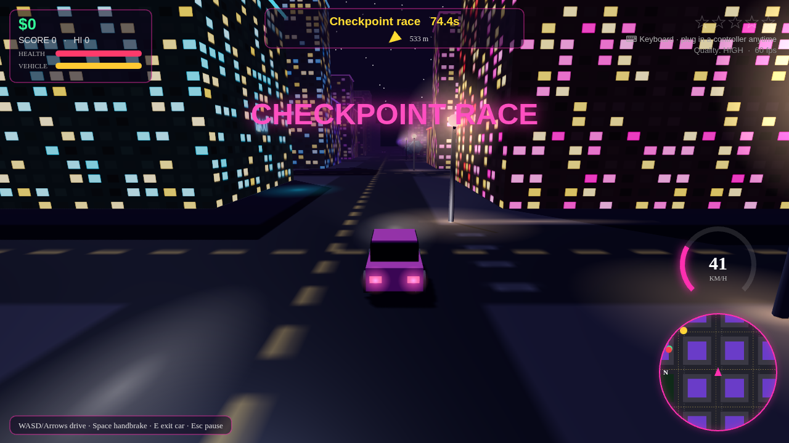
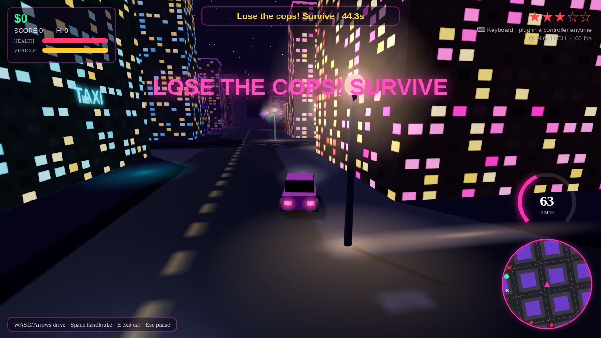

# Neon Bay

An original open-world driving game set in a neon city at night. Runs in a single HTML file in Chrome or Edge, with full gamepad support. 3D version: chase camera, lit towers with neon signs, car models with working headlights, wet reflective streets, cop lights, engine and siren audio.

## How to play
1. Download `neon-bay.html` and double-click it (Chrome or Edge).
2. Press any controller button or key on the title screen so the browser detects the gamepad and enables sound.
3. If it stutters, open the pause menu and set **Quality** to LOW.

Missions: deliveries, races and cop escapes. Police chases raise your wanted stars.

## Controls (gamepad)
| Input | Action |
|---|---|
| Left stick | Steer |
| RT | Gas |
| LT | Brake / reverse |
| A | Handbrake |
| Y | Enter / exit car |
| Start | Pause |

## Screenshots

